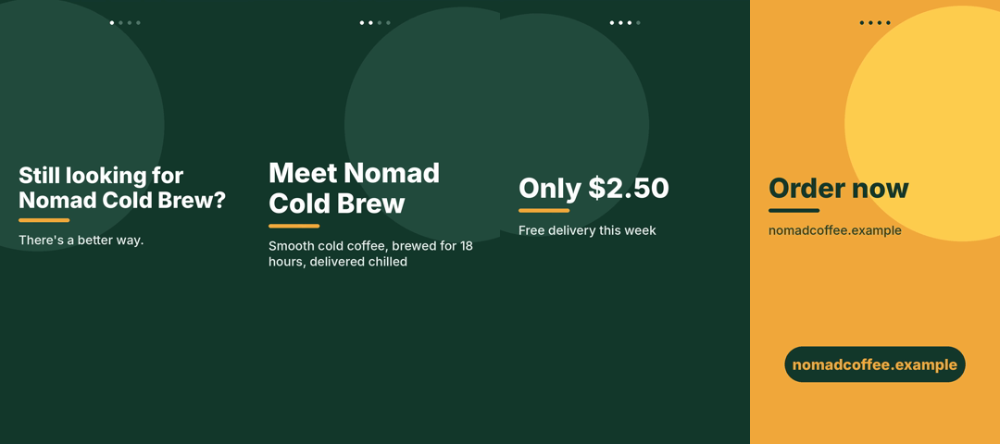

# ai-ad-video-agent

**Write a short brief and get back a vertical video ad.** The agent writes the script with Claude, adds a neural voiceover in English or Somali, animates the text and renders a 1080×1920 MP4 that's ready for TikTok, Reels, Shorts or WhatsApp Status.


<p align="center"></p>

## From brief to video

```json
{
  "product": "Nomad Cold Brew",
  "description": "Smooth cold coffee, brewed for 18 hours, delivered chilled",
  "audience": "Busy students and office workers",
  "price": "$2.50",
  "offer": "Free delivery this week",
  "cta": "Order now",
  "contact": "nomadcoffee.example",
  "language": "en",
  "duration": 16
}
```

```bash
ad-agent examples/brief.json --no-voice
```

Output from a run without an API key, so the built-in template writes the script:

```
✍️  Script (template): 4 scenes
    [   hook] Still looking for Nomad Cold Brew?
    [feature] Meet Nomad Cold Brew
    [  offer] Only $2.50
    [    cta] Order now
🎬 out/nomad-cold-brew.mp4  (16.0s, 1080×1920)
```

With `ANTHROPIC_API_KEY` set, Claude writes the script instead, usually 4 to 6 scenes. With `edge-tts` installed, each scene also gets a voiceover and its length is fitted to the audio.

You get `out/nomad-cold-brew.mp4`, a `.png` thumbnail, and the `.script.json`. You can edit the script by hand and render it again with `--script`.

## Pipeline

```
brief.json ─► Claude writes the script ─► edge-tts voiceover ─► scene timing fitted to the audio ─► Pillow frames ─► ffmpeg MP4
              (offline template fallback)  (optional, en / so)
```

| Stage | Module | Notes |
|---|---|---|
| Script | `ad_agent/script.py` | Hook → features → offer → CTA. The prompt tells the model never to invent stats or testimonials. Malformed JSON gets one retry. |
| Voice | `ad_agent/voice.py` | Free Microsoft neural voices, Somali included (`so-SO-UbaxNeural`). If TTS fails, the video renders silent. |
| Motion | `ad_agent/render.py` | Lines slide up with ease-out, accent bar grows, background drifts, CTA button pulses, progress dots |
| Encode | `ad_agent/render.py` | Frames are piped straight into ffmpeg (H.264, `+faststart`), and the voice clips are mixed in at the start of each scene |

## Install

```bash
# ffmpeg is required: apt install ffmpeg / brew install ffmpeg
pip install "ad-agent[ai,voice] @ git+https://github.com/abdimalikhussein25/ai-ad-video-agent"
export ANTHROPIC_API_KEY=sk-ant-...   # optional; without it a built-in template writes the script
```

## Options

```bash
ad-agent brief.json -o out/            # output folder
ad-agent brief.json --no-voice         # silent video with text only
ad-agent brief.json --script my.json   # render a script you edited
ad-agent examples/brief.so.json        # Somali ad
```

Set brand colours with `brand_color` / `accent_color` in the brief. Override the model with `AD_AGENT_MODEL`.

## Roadmap

- [ ] Product photo and logo layers
- [ ] Background music with automatic ducking under the voice
- [ ] Batch mode: one brief, several hook variations for A/B testing
- [ ] Burned-in subtitles

## Tests

```bash
pip install -e ".[dev]"
pytest
```

## License

MIT © Abdimalik Salad Hussein · [Fiddo Technology](https://fiddotechnology.com)
